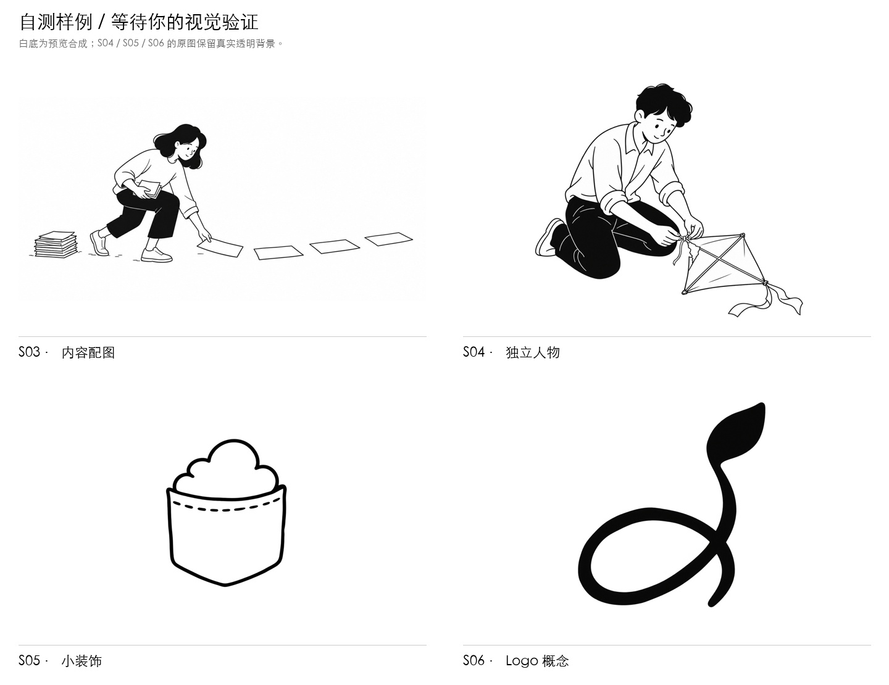
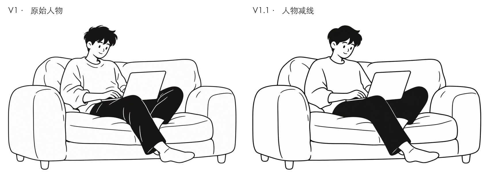
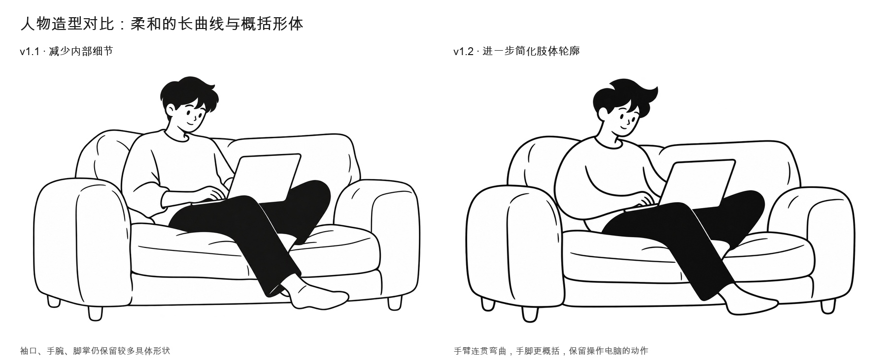
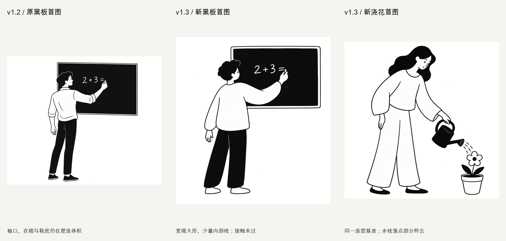

# Notion Handdrawn Studio

**把一个想法，画成干净克制的黑白手绘。**

一个面向 Codex 的插画创作 Skill，以 Notion 官网的手绘视觉语言为研究参考，支持内容配图、独立人物与物件、小装饰和原创 Logo 概念。没有固定主角：人物、动作和构图随你的内容变化。

当前版本：**v1.3.0** · [版本记录](CHANGELOG.md) · [Skill 指令](skills/notion-handdrawn-studio/SKILL.md) · [MIT 许可证](LICENSE)



## 想要的画风

自然、连贯，略有不规则的黑色墨线；简化五官；适量黑色实面；充足留白。用一个清楚的动作或关系表达意思，让轻微的趣味留在画面里。

人物优先通过**外轮廓、姿态和黑白块面**表达。衣褶、手指、鞋纹和碎发只保留识别动作所需的细节。允许轻微比例概括，保留身体支撑、接触关系与人物状态。

默认黑白、无文字。用户指定的颜色、文字、比例、背景和人物特征可以覆盖默认值。

## 可以做什么

| 用途 | 适合的请求 | 创作重点 |
| --- | --- | --- |
| 内容配图 | 文章、段落、观点、网页首屏 | 找到核心意思，安排动作、关系与留白 |
| 独立插画 | 人物、动物、物件、一个小场景 | 主体清楚，姿态自然，细节克制 |
| 小装饰 | 页面边角、正文旁、贴纸 | 轮廓简洁，适合缩小，按需透明 |
| Logo 概念 | 原创图形标志、名称搭配 | 单色识别、小尺寸可读、外形压缩 |

也支持配图规划、仅提示词，以及对已有图片进行指定范围的编辑。

## 安装与第一次使用

1. 下载本仓库，或克隆到本地。
2. 把整个 `skills/notion-handdrawn-studio` 文件夹复制到你的 Codex 个人 skills 目录。通常为 `~/.codex/skills/`；使用自定义 `CODEX_HOME` 时，放入该目录下的 `skills/`。
3. 在能识别该 Skill 的 Codex 对话里，直接调用 `$notion-handdrawn-studio`。

```text
使用 $notion-handdrawn-studio：
画一个坐在沙发上用笔记本电脑的男生，状态非常舒适。
黑白、人物细节少一点、真实透明背景，只生成一张。
```

请复制完整文件夹，保留 `references/` 和 `agents/` 等内容。Skill 按任务选择参考，无需把整个参考库贴进对话。

实际出图需要所在 Codex 环境提供内置 `image_gen` 工具。这个仓库提供创作指令、参考和检查方法，生成能力由运行环境提供；也可以明确要求只输出规划或提示词。

## 四种使用示例

**为内容配图**

```text
使用 $notion-handdrawn-studio，为“把复杂目标拆成每天能做的小事”配图。
先稍微优化这个概念，再生成一张横向插画。
希望动作一眼能看懂，画面有留白。
```

**画一个人物**

```text
使用 $notion-handdrawn-studio，画一个正在给花浇水的女生。
轻松自然，衣服和头发概括一些，黑白透明底，只生成一张。
```

**做一枚小装饰**

```text
使用 $notion-handdrawn-studio，画一台小小的笔记本电脑，
用于放在正文边角。轮廓简单，屏幕不放文字，透明背景。
```

**设计 Logo 概念**

```text
使用 $notion-handdrawn-studio，为“慢想”设计一个原创图形 Logo。
表达安静思考，用一个清楚的视觉关系，黑白，缩小后仍能识别。
先生成一个概念，不加文字。
```

如果用于网页首屏，可以补充“人物放右侧，左侧留给标题”；如果已有图片，可以附图并说明要保留和修改的部分。

## v1.1：人物做减法

第一轮用户反馈是：**人物细节太多，Logo 和装饰的方向可以保留。** v1.1 据此收紧人物的内部线条，保留姿态与动作，Logo 和小装饰的模式规则延续 v1。



这组对比来自**一次针对已有图片的编辑**。上衣重复衣褶和黑裤子内部白线明显减少，头发与手部简化较轻。画面视觉上保留了靠坐状态、沙发、电脑和构图；没有验证像素级一致性。

两张原图均为 1536 × 1024，已检查实际透明通道。新的主题能否持续保持同样的简洁程度，以及用户对 v1.1 的审美复核，仍待后续验证。

[编辑前 PNG](evaluations/v1.1.0/before.png) · [编辑后 PNG](evaluations/v1.1.0/after.png) · [完整提示词与自评](evaluations/v1.1.0/review.json)

## v1.2：进一步概括肢体

人物从减少内部线条，进一步调整为柔和长曲线和概括的手脚形状。已有沙发图的一次编辑有改善，但独立生成的黑板男生仍出现具体袖口、手腕和鞋底；该新图被记录为需要调整，不能据编辑样例宣称稳定。



[v1.2 完整 Skill 快照](versions/v1.2.0/notion-handdrawn-studio) · [安装包](downloads/notion-handdrawn-studio-v1.2.0.zip) · [验证与提示词](evaluations/v1.2.0/README.md)

## v1.3：统一人物造型基准

新图使用同一段正向造型基准，先以宽缓平面大形组织人物，再补主题、动作与构图。外轮廓、内部细节和动作接触分别判断，首图不会被修图结果覆盖。



两例独立新图都减少了人物细节，但线条仍偏光滑、圆润。黑板粉笔接触经一次修正仍未完全解决，浇花水线未明确落入盆土。**这是改进版，稳定性仍待验证，用户审美评价尚未完成。**

[v1.3 完整 Skill 快照](versions/v1.3.0/notion-handdrawn-studio) · [安装包](downloads/notion-handdrawn-studio-v1.3.0.zip) · [验证与实际提示词](evaluations/v1.3.0/README.md)

## 验证与效果边界

我们保留真实图片、提示词、检查记录和已知问题，便于比较版本。规则走查与实际出图分别记录。

| 验证项 | 已完成的范围 |
| --- | --- |
| v1.0 实际出图 | 正文配图、人物、小装饰、Logo，各一张 |
| v1.0 规则走查 | 仅规划、仅提示词、默认值覆盖、编辑范围，共四项 |
| v1.0 后续案例 | 四个新主题已设置，待用户参与验证 |
| v1.1 实际编辑 | 沙发男生的人物减法，一次编辑 |
| v1.1 邻近场景 | 用书辅导的首屏人物，仅规则走查 |
| v1.2 实际验证 | 沙发编辑一次；黑板新图一次，造型需调整 |
| v1.3 实际验证 | 黑板、浇花独立新图各一次；黑板局部编辑一次，接触仍未完全解决 |
| 文件与结构 | Skill 格式、参考哈希、示例透明通道、首版 Logo 缩略效果 |

[首版自评](evaluations/v1.0.0/self-review.json) · [首版完整提示词](evaluations/v1.0.0/prompts.txt) · [当前验证案例](skills/notion-handdrawn-studio/validation/cases.json) · [Logo 小尺寸检查](evaluations/v1.0.0/previews/logo-size-check.jpg)

下载仓库后，可用浏览器打开 `evaluations/v1.0.0/index.html` 查看首轮验证页并填写反馈，也可打开 `evaluations/v1.1.0/index.html` 查看修订对比。GitHub 上的 HTML 链接显示源文件；图片可以直接预览。

图像结果会随主题和生成环境变化。Logo 交付是位图概念，不能当作已完成的可编辑矢量标志或完整品牌系统。

## 仓库结构与回溯

```text
skills/notion-handdrawn-studio/  可安装的 Skill
  SKILL.md                     用途、默认值与工作方式
  references/                  画风、分用途指引与 12 张精选参考
  validation/                  验证方法与案例集
evaluations/v1.0.0/             首版样例、提示词与检查记录
evaluations/v1.1.0/             人物减法对比与自评
versions/                      v1.2 起的完整 Skill 快照
downloads/                     对应版本安装包
evaluations/v1.2.0/             肢体抽象编辑与黑板新图测试
evaluations/v1.3.0/             两例新图回归及局部编辑
VERSION                        当前版本号
CHANGELOG.md                   版本变更
v1.0.0-manifest.json            首版历史文件清单
v1.1.0-manifest.json            v1.1 发布文件清单
```

通过 [提交历史](https://github.com/luyuzhe-1/notion-handdrawn-studio/commits/main) 回溯改动。[v1.0.0 历史快照](https://github.com/luyuzhe-1/notion-handdrawn-studio/tree/16564dba9daff7c44f251ab4265528bc158d4297) 固定在首版远端提交；版本号与提交记录配合使用，不依赖本地标签。

## 贡献与反馈

欢迎提交 Issue 或 Pull Request。反馈时最好附上：使用的版本、原始请求、生成图片，以及希望保留或减少的细节。人物是否太碎、动作是否清楚、缩小后是否可读，都是有用的观察。

对画风的改动请附前后对比，并标明是新图生成还是已有图编辑。不要把一次成功样例视为所有主题都已验证，也不要提交密钥或私人内容。

## 许可证与参考来源

本项目自行编写的 Skill 指令、文档和验证说明采用 [MIT License](LICENSE)，可以使用、修改和分发，并保留许可声明。

`skills/notion-handdrawn-studio/references/visuals/` 内的 Notion 官网原图及其预览属于第三方参考材料，**不在本项目 MIT 许可范围内**。逐图来源、采集日期和哈希保存在 [参考索引](skills/notion-handdrawn-studio/references/visual-index.json)，授权边界见 [第三方素材说明](THIRD_PARTY_NOTICES.md)。本项目未核实这些图像的独立作者或再分发授权，不替第三方素材授予权利。

生成样例用于展示验证过程，其使用还需遵循相应生成服务的适用条款。创作时参考视觉语言，避免直接复用官网角色、构图或品牌标记。

这是独立社区项目，与 Notion 没有隶属、赞助或官方合作关系。
