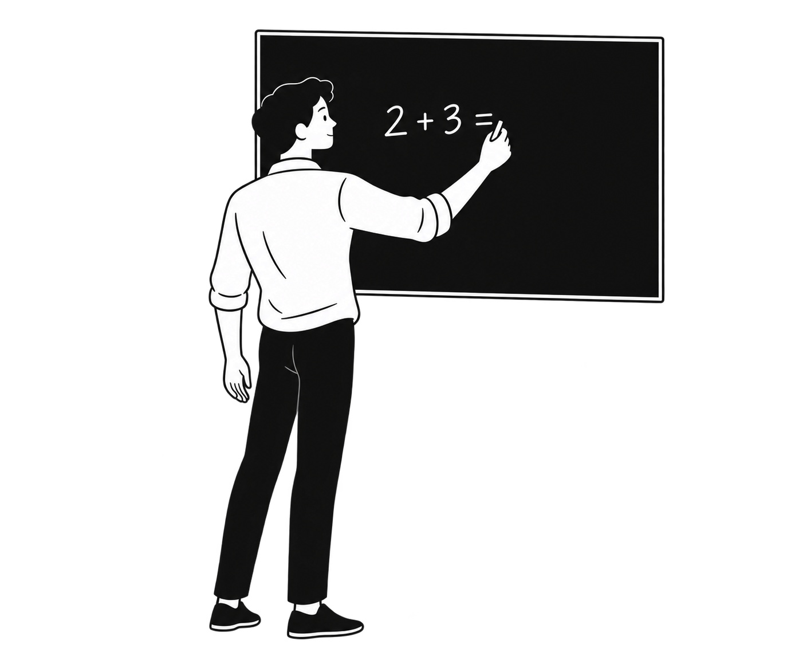

# v1.2.0 验证记录

人物肢体改为柔和长曲线与概括块面，并允许编辑时重塑轮廓。

- 沙发男生：一次带风格参考的已有图编辑，手臂和鞋形更简洁。
- 黑板写题男生 U05：一次独立新图；袖口、手腕、手指、鞋底仍偏具体，造型需要调整。粉笔接触也不够明确。
- 两种流程分别记录，编辑改善不能证明新图生成稳定。用户审美验证待进行。

[沙发自评](review.json) · [编辑提示词](edit-prompt.txt) · [黑板提示词](blackboard-boy/prompt.txt) · [黑板自评](blackboard-boy/review.json)

下载仓库后可打开本目录 index.html 和 blackboard-boy/index.html；GitHub 直接展示 HTML 源码。
